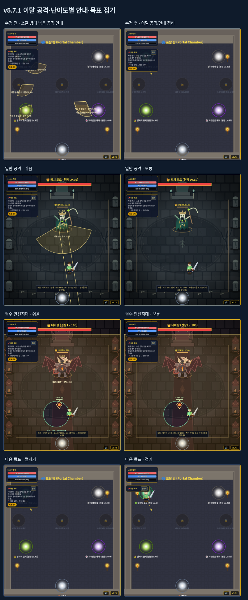

# v5.7.1 — 던전 이탈과 공격 안내, 다음 목표 창

공격 준비 중 던전을 나왔을 때 포탈 방에 공격 범위·이름·남은 시간이 남던 문제를 수정했습니다. 다음 목표 창에 접기/펼치기를 추가하고, 난이도별 공격 안내도 요청한 정책으로 변경했습니다.

## 이탈 후 남던 공격

기존 출구 처리는 일부 효과를 비웠지만 적 목록과 개체에 연결된 공격은 남겨 두었습니다. 마지막 공격 안내 레이어도 전투 지역을 확인하지 않아 포탈 방에서 이전 적의 예고를 계속 그렸습니다.

던전/탑 출구에서 이전 적의 공격 참조, 적 목록, 예약 소환, 투사체, 장판과 적 효과를 함께 정리합니다. 포탈을 탄 틱에는 이전 구역의 스폰/AI 처리를 계속하지 않습니다. 전투 지역 밖이거나 현재 적 목록에 속하지 않은 개체의 안내를 그리는 것도 차단합니다. 이전 던전 구역으로 돌아가면 목적 구역의 새 개체만 배치합니다. 보스 재소환 대기, 탑 진행/최고층, 자원·스킬 쿨타임과 전투 이탈 기록은 기존 규칙으로 이어집니다.

## 난이도별 표시

| 항목 | 쉬움 | 보통·어려움 |
| --- | --- | --- |
| 일반 근접·돌진·탄막 등의 범위 안내 | 표시 | 숨김 |
| 공격 이름·준비/공격/후딜 남은 시간 | 표시 | 숨김 |
| 회피에 필요한 필수 범위 | 표시 | 범위만 표시 |
| 실제 적 몸체·공격 동작·투사체 | 표시 | 표시 |

필수 범위는 다음과 같이 구분합니다.

- 슬라임 킹·페릴: 본체에서 떨어져 발생하는 보스 도약의 착지 지점. 일반 개체의 도약에는 같은 예외를 적용하지 않습니다.
- 슬라임: 산성 비와 남은 산성 장판의 경계.
- 리치: 생명력 흡수 광선, 부활 의식의 안전 원과 의식 범위.
- 사령왕: 순서대로 발생하는 손의 지면 범위와 안전 회랑.
- 대마왕: 연속 균열, 다중 낙인, 심판 범위와 안전 원.
- 스승 결투: 운석 등 위치가 고정된 지면 광역과 안전지대. 일반 회전 베기의 준비 범위나 발도/저격 조준선은 쉬움에서만 표시합니다.

효과 강도0에서도 필수 경계와 실제 투사체를 유지합니다. 쉬움 이외에는 필수 기술도 이름·남은 시간·순서 숫자 등의 안내 문구를 덧붙이지 않습니다. 일반 공격의 활성 순간에 그리던 별도 범위 오버레이도 같은 정책을 따릅니다. 보통·어려움에서는 공격 모션과 실제 투사체를 읽어 대응합니다.

## 다음 목표 접기

목표 창 제목 옆의 **접기/펼치기** 버튼으로 내용과 목표 선택 버튼을 숨기거나 다시 표시합니다. 접은 동안에도 실제 목표와 진행 내용은 갱신되며, 펼치면 최신 상태를 보여 줍니다. 키보드로 조작할 수 있고 `aria-expanded`를 갱신합니다.

표시 상태는 같은 브라우저에서 재접속·새 게임·슬롯 교체 후에도 기억합니다. 화면 설정으로 별도 보관하며 캐릭터 저장에는 추가하지 않습니다. 설정 저장에 실패해도 현재 실행에서 접기/펼치기는 동작합니다. 작은 화면의 캐릭터 정보 패널과 큰 글자에서도 확인했습니다.

## 검증

`npm run test:warnings`는 위 동작을13개 검사로 확인합니다. 출구는 실제 포탈 좌표와 게임 틱으로 실행하고, 이전 적의 공격 참조를 보관한 콜백도 더는 그리지 않는지 검사합니다. 다섯 종족의 일반/필수 공격을 세 난이도에서 확인하고, 공격 범위·시간·이름의 숨김과 실제 투사체 표시를 분리해 검증합니다.

전체 검사 `npm test`의431개와 전용13개가 통과했습니다. 기존 전투·피해·보상·기록·저장·입력·접근성·픽셀/시간 회귀 검사도 포함합니다. 낫 파동의 기존 검사는 쉬움의 예고를 확인한 뒤 원래 난이도로 되돌려 실제 원거리 도달·중복 피격 방지를 검사합니다. 공격 수치·실제 판정·공격 타이머와 난이도 배율은 수정하지 않았으며, 저장 형식8과 전투 비교 기준5.7.0도 유지합니다.
