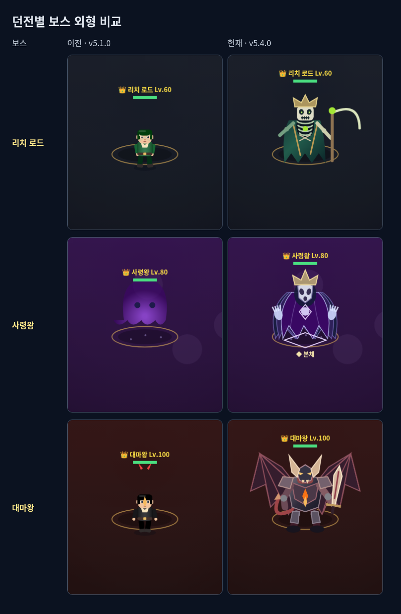

# v5.4.0 마왕성 — 대마왕 / 몬스터 개편 최종 통합

## 외형과 동작

하급 악마는 뿔·발톱·꼬리·작은 날개와 짧은 화염, 암흑 기사는 닫힌 투구·갑옷 관절·방패·대검, 장군은 큰 날개·지휘 장식과 전장 기술을 갖습니다. 대마왕은 넓은 어깨와 갑주, 큰 뿔·날개 막/뼈대, 왕검과 흉부 핵으로 구분합니다. 이동 시 다리/무릎/발, 준비 시 무기/어깨와 날개 펼치기, 연격의 서로 다른 검 회전, 내려찍기·질주·회수 동작을 연결했습니다. 2단계에 갑옷/날개가 손상되고 3단계에 큰 핵이 드러납니다. 세 던전 보스 모두 사망 시 몸체가 무너지고 해당 재질 파편으로 사라집니다.

## 대마왕의 여섯 기술

60틱=1초. 보통 난이도 기준이며 쉬움은 준비시간×1.3, 왕검의 후속 예고도36→47틱으로 늘립니다. 진행/판정은 화면 주사율과 독립된 게임 틱으로 처리합니다.

| 기술 | 준비 / 공격 / 후딜 | 실제 메커니즘과 대응 |
| --- | --- | --- |
| 왕검 연격 | 80 / 68 / 108 | 고정 전방 2회. 반경185+16/213+16, 반각1/1.3rad, 간격36틱. 후방/범위 밖 회피 후 검 회수 중 공격 |
| 파멸 질주 | 78 / 28 / 105 | 최대340px, 경계로 제한된 실제 종점/방향을 먼저 표시. 선에서 옆으로 회피. 한 번만 피해 |
| 대지 균열 | 92 / 90 / 125 | 고정 방향의 5개 원을 모두 예고, 18틱 간격 전파. 반경46+16. 옆길로 이탈 |
| 날개 폭풍 | 96 / 1 / 120 | 7발, 각도 간격0.3rad, 속도2.8px/틱, 반경10. 탄막 틈으로 이동. 한 시전 합계 최대1회 피해 |
| 지옥의 낙인 | 86 / 60 / 112 | 이전 위치 주변 3개 원을 모두 예고, 24틱 간격 발동. 반경60+16, 발동 후 지속 피해 없음 |
| 종말의 심판 | 180 / 1 / 210 | 표시된 안전 원(캐릭터 중심 허용반경89) 또는 HP100 심판 핵 파괴. 중단/발동 뒤 모두210틱 공격 기회, 보스에게 주는 피해×1.25 |

체력70%/35%에서 다음 패턴부터 2/3단계가 됩니다. 1단계 연격/질주 → 2단계 균열/폭풍 → 3단계 낙인/심판 추가. 이미 준비 중인 공격과 후딜은 끝까지 유지합니다. 순간이동 즉시 피해·추적이 끝나지 않는 장판·보이지 않는 접촉 피해는 제거했습니다.

보스 원시피해는 연격69/77, 질주77, 균열77(원별1회), 폭풍69(탄막 전체1회), 낙인69(원별1회), 심판87입니다(Lv.100). 공통 방어/난이도를 적용합니다. 일반 몬스터는8+레벨×0.45이며 동시 준비/공격을2개로 제한합니다. 흑기사의35% 방패 감소는 활성48틱 뒤 해제됩니다. 전용 탄24개·파편/장식48개·심판 핵1개 상한을 적용합니다.

## 이전과 달라진 밸런스

- 이전 대마왕: 1~8번 기술 동안 **95% 피해 감소**, 마지막 기술 뒤600틱 경직. 새 버전: 기술 중 기본 감소 **0%**, 각 기술 뒤105~210틱 후딜. 심판 뒤 추가 피해25%. 특정 긴 경직만 기다리는 전투를 없앴습니다.
- 대마왕 HP14400(보통), 기존 레벨/골드/XP/드롭, 던전 일반25·정예3·생존90초와 저장 형식6은 유지합니다. 리치6400/사령왕10000 HP도 유지합니다.
- 받는 피해는 읽고 피하는 공격 이벤트에만 연결했습니다. 낙인·균열·손은 처음부터 위치/순서를 표시하고 발동 뒤 추가 추적/강제 빙결을 하지 않습니다.
- 리치/사령왕/대마왕에 전용 시전·무거운 착탄·단계 전환 효과음과 붕괴 연출을 연결했습니다. 음량·음소거·효과 강도·흔들림 설정을 따르며 효과0에서도 몸체·안전지대·공격 예고·투사체를 유지합니다.

## 실제 평타/회피 측정

`tests/monster-integration.test.cjs`는 실제 캔버스 공격 입력 처리기를 사용합니다. 검/활/지팡이를 각각 세 보스와 쉬움/보통/어려움에 조합해 검사했습니다.

측정 조건: Str50/Vit40/Atk30/Agi10, 용사의 대검/용의 활/대마법사의 지팡이, 치명타 없음, 보스와90px, 120틱 동안 평타 입력 후 남은 탄착30틱 정산, 스킬/버프/각성/마나 사용 없음. 후딜을 고정한 비교 검사이며 전체 전투 처치 시간으로 해석하지 않습니다.

| 무기 | 2초 입력 피해 | 세 던전·3난이도 후딜 중 결과 |
| --- | --- | --- |
| 검 | 736.77 | 피격/마나 소비 없음 |
| 활 | 401.13 | 피격/마나 소비 없음 |
| 지팡이 | 625.78 | 피격/마나 소비 없음 |

세 무기 모두 실제 평타로 의식 봉인석과 심판 핵을 준비 시간 안에 파괴할 수 있음을 검사했습니다. 기본 달리기(이동 스킬 없음)로 세 보스의 모든 피해 패턴에서 안전한 경로를 찾아 실제 이동을 실행하고, 시전/탄착이 끝날 때까지 무피격임을 확인했습니다. 경계 바로 앞이 아닌14px 여유를 가진 목표를 사용합니다. 쉬움/보통/어려움 장기 전투는 별도로 각각 수행하며, 이 회피 측정은 보통 기준입니다. 사람의 반응 속도·장시간 체감 밸런스는 자동 검사와 구분합니다.

## 검증과 관리자

- `npm run test:demon`: 6패턴 고정 목표·무피해 렌더·후딜, 2연격/쉬움 간격/후방, 실제 질주 경계·1회 타격, 균열5/낙인3회, 폭풍7발·틈·단일 피해, 심판 안전/중단·추가 피해, 단계 지연/방패 해제, 일반 역할·공격 상한, 탑25층/보상1회/이탈 정리, 관리자6패턴, 3난이도 장기 전투·효과0.
- `node --test tests/monster-integration.test.cjs`: 실제3무기×3보스×3난이도 평타, 무기별 의식/심판 중단, 달리기 회피, 신규 리치/대마왕30·60·144Hz 일치(사령왕은 전용 검사).
- `npm test`: 다섯 던전·탑·스승, 의뢰·각성·드롭 경로, 사망/재도전·엔딩·저장/불러오기·관리자 저장 분리·입력·접근성·작은 화면을 함께 회귀 검사합니다.
- Chromium에서 신규 세 보스의1/2/3단계·모든 패턴 준비/발동·사망·각3종 일반몹·320×360/효과0 화면을 캡처하고 페이지 오류를 확인합니다.

설정→관리자 코드6974→‘보스 패턴·판정 실험실’에서 던전/패턴/1~3단계를 고른 뒤 ‘선택 패턴 준비’를 누릅니다. ‘이 상태로 플레이’ 또는 ‘한 틱 진행’으로 확인하며 AI 정지·판정 표시를 함께 쓸 수 있습니다. 일반 저장은 보호되고 관리자 종료 시 기존 진행으로 복귀합니다.

로컬 최종 검증: 전체311개 통과, 마지막 투사체 예고 거리/소유자 이동 보완 후 몬스터 전용94개 및 관리자·리치45개 통과. `git diff --check` 및 HTML 스크립트 구문/패키지 버전 일치 확인 완료.
