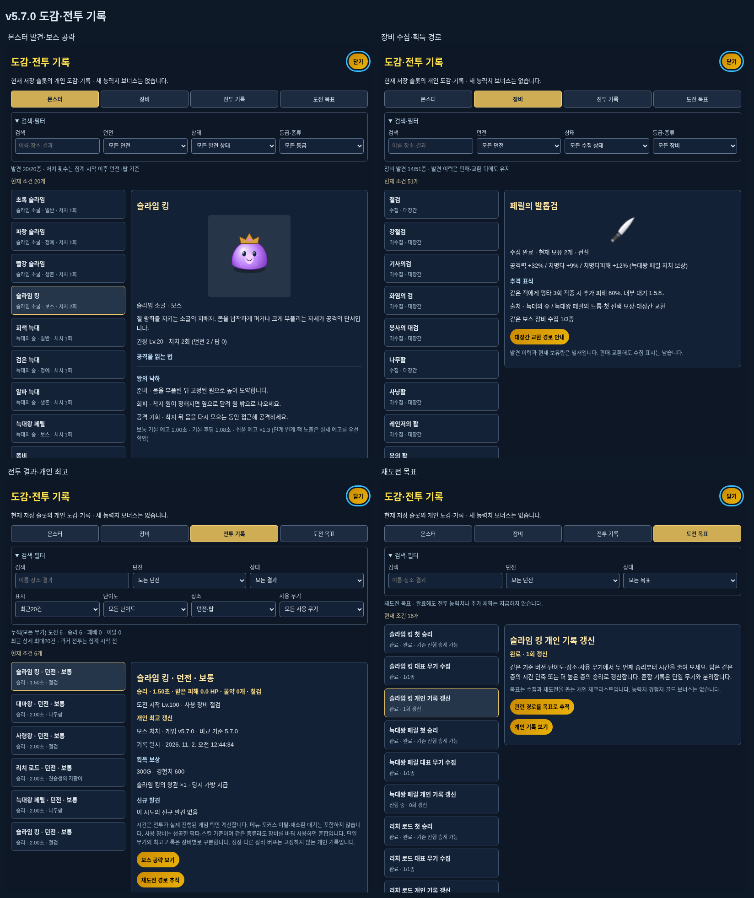

# v5.7.0 — 도감·전투 기록 3차

일시정지 메뉴에 **도감·전투 기록**을 추가했습니다. 몬스터·장비·전투 기록·도전 목표의 네 탭으로 발견, 공략, 수집 경로와 개인 보스 기록을 확인합니다. 기존 최근 피격8회와 사망/즉시 재도전 화면은 유지합니다. 장비·보상 → 전투 화면·연출 → 도감·전투 기록의 세 차수를 마무리합니다. 난이도·성장·공격·드롭·특성·교환 수치는 이번 차수에서 조정하지 않습니다.

## 몬스터20종과 보스 공략

- 다섯 던전의 일반·정예·생존·보스를 각각 한 항목으로 정리합니다. 실제 전투 목록에 등장하면 발견하며, 다른 등급이나 보스를 만났다고 한 가족 전체를 열지 않습니다. 단순한 몬스터 생성 함수·미리보기는 발견을 만들지 않습니다.
- 정상 플레이의 실제 처치만 한 번 기록합니다. 같은 적에 대한 중복 사망 호출은 무시하고, 작은 분열체·늑대 무리·호위·환영·의식 대상·심판 핵은 본종 처치 수와 일반 보상을 늘리지 않습니다.
- 던전/탑의 발견을 같은 도감에서 확인하되 처치 횟수는 던전과 탑을 나눠 표시합니다. 기존 정예 구역의 기본 개체와 강화된 정예 개체는 해당 구역의 같은 종으로 집계합니다.
- 미발견은 이름/공략을 잠그고 실루엣으로 표시합니다. 발견 후 실제 몸체·설명·권장 레벨·등장 구역·처치 수·보상 연결이 열립니다. 2배 해상도의 초상화는 게임 캔버스·게임 상태·난수를 바꾸지 않습니다.
- 슬라임 킹4개, 페릴4개, 리치4개, 사령왕5개, 대마왕6개의 주요 패턴에 준비 동작·예고 모양·회피 방향·후딜의 공격 기회를 설명합니다. 기본 예고/후딜은 실제 공격 데이터에서 읽고, 쉬움 배율과 연계/핵 노출의 예외도 안내합니다.

## 장비51종의 수집과 경로

대장간/던전 장비51종의 발견과 미수집 상태, 능력치·고유 특성, 획득 던전/보스·구매·교환 경로를 표시합니다. 소비 물약은 장비 도감에서 제외합니다. 같은 보스 장비 수집 현황과 현재 가방+착용+보관함의 보유량도 보여 줍니다.

발견 이력은 1차의 보상 원장을 사용하므로 판매·교환·탈착 뒤에도 남습니다. 가방 만석 드롭과 첫 선택/교환 결과도 동일한 원장으로 이어집니다. 거래 저장 실패로 취소된 장비는 발견이나 전투의 신규 장비 목록에 남기지 않습니다.

획득 경로/보스 재도전/대장간 교환을 누르면 기존 목표 HUD와 지도 간 출구 안내에 연결합니다. 새로운 추적 ID는 저장 검증에 등록하며 실제 입장 조건을 적용합니다. 이미 정복한 던전도 수집·재도전 경로를 추적할 수 있습니다. 경로 안내가 입장 조건을 우회하거나 아이템을 지급하지는 않습니다.

## 개인 전투 기록과 비교 조건

실제 보스가 등장할 때 시도를 시작하고 승리·패배·중도 이탈로 한 번 종료합니다. 재소환 대기에는 시도를 만들지 않으며, 재도전은 새 ID로 시작합니다. 몬스터 생성·그리기·메뉴 재그리기는 시도나 피해를 만들지 않습니다.

| 기록 | 집계 규칙 |
| --- | --- |
| 시간 | 실제 진행한60Hz 게임 틱. 메뉴·도감·일시정지·포커스 이탈·히트스톱·재소환 대기 제외 |
| 받은 피해 | 방어력 적용 후 실제로 줄어든 HP. 마지막 과잉 피해는 남아 있던 HP까지만 집계 |
| 물약 | 실제 효과를 적용해 소비한 회복·마나·버프 물약 수 |
| 레벨·무기 | 도전 시작 레벨과 성공한 평타/스킬의 실제 장비 ID/이름. 단순 교체와 실패한 스킬은 제외 |
| 보상 | 전투 중 실제 지급된 골드·보정 후 경험치·장비 드롭 수량과 당시 가방/보관함 위치, 각성 재료, 첫 선택권 |
| 신규 발견 | 해당 시도에서 새로 발견한 종과 장비. 나중에 선택한 보상 장비는 도감에 반영하며 과거 전투 드롭으로 소급하지 않음 |

단일 무기의 최고 기록은 **보스·난이도·던전/탑·실제 장비 ID**로 구분합니다. 같은 검 종류라도 다른 검을 써서 공격하면 혼합이며 단일 장비 최고 기록을 갱신하지 않습니다. 무기를 바꾸기 전에 발사한 공격은 원래 장비 ID를 유지합니다. 맨손/무기 미사용도 별도입니다. 레벨·방어구·버프는 고정하지 않는 개인 기록이며, 시작 레벨·사용 장비를 함께 보고 비교합니다.

탑은 각 비교 조건의 **최고 클리어 층과 그 층의 최고 시간**을 보관합니다. 높은 층 승리는 최고층 갱신으로 표시하고, 같은 층에서만 시간을 비교합니다. 낮은 층의 빠른 승리가 높은 층 기록을 덮지 않습니다. 낮은 층의 상세는 최근20건에서 확인합니다. 기존 탑 최고층, 던전 목표/처치 여부, 첫 선택 보상은 각각의 기존 규칙을 유지합니다. 스승 결투는 이 다섯 보스 기록에 넣지 않습니다.

버전과 비교 기준을 함께 저장합니다. 현재 기준은 `5.7.0`입니다. 이후 기준이 바뀌면 이전 기록은 표시하되 새 기준과 시간을 비교하지 않고, 해당 조건의 첫 새 승리로 현재 기준 최고를 시작합니다. 최근 기록에 남은 이전 시도는 유지합니다.

## 전투 결과와 재도전 목표

승리 후 위험이 없는 동안 **전투 결과 보기**를 표시합니다. 결과를 열면 시간·실피해·물약·레벨/사용 장비·보상/보관 위치·신규 발견을 한 화면에서 확인하며 첫 승리·첫 기준 기록·개인 최고/탑 최고층 갱신을 표시합니다. 결과 확인을 강제하는 모달은 자동으로 열지 않습니다. 패배 화면에도 해당 보스의 상세 링크가 있고, 돌아가도 기존 즉시 재도전 버튼과 조건이 유지됩니다.

최근 상세는 최대20건이며 누적 도전/승리/패배/이탈과 최고 기록은 별도로 보관합니다. 검색·던전·결과·난이도·장소·사용 무기 종류와 최근/최고 필터를 제공합니다. 누적 도전 수는 모든 무기 합계라고 표시합니다.

도전 목표는 다섯 보스의 던전 첫 승리, 대표 특성 무기7종 수집, 보스별 개인 기록 갱신과20종 발견입니다. 완료해도 능력치·경험치·골드 보너스를 만들지 않습니다. 단일 무기는 같은 장비로, 혼합은 혼합끼리 비교하며 갱신 목표는 두 번째 비교 가능한 승리부터 진행할 수 있습니다.

## 저장8과 관리자 분리

- 저장 형식을8로 올리고 슬롯별 도감/기록을 추가했습니다. 이전 버전의 보스 처치 상태로 확인 가능한 보스만 발견 상태를 승계하며, 과거 처치 수·시도 수·시간·피해는 추정하지 않습니다. 화면에 ‘집계 시작 전’을 안내합니다.
- 장비는 기존 발견 이력과 현재 착용/가방/보관함에서 확인 가능한 항목을 승계합니다. 1차 이전에 이미 판매한 장비의 이력은 만들지 않습니다. 수동·자동·백업·파일 가져오기와 관리자 복구에도 같은 검증/변환을 적용합니다.
- 기존처럼 전투 저장을 불러오면 마을에서 시작합니다. 저장용 복사본에 진행 중 시도를 중도 이탈로 마감하며 실제 진행 중인 전투는 계속됩니다. 현재 전투에서 승리해 다시 저장하면 같은 시도의 승리 결과로 대체됩니다. 반복 저장/불러오기로 시도가 두 번 생기거나 오프라인 시간이 더해지지 않습니다.
- 저장 검증은 알려진 종/장비·단계/장소·수치·중복 ID·누적 수와 승패 합·실제 처치와 승리 수·최근/최고의 동일 시도 일치를 확인한 뒤 상태를 적용합니다. 저장 실패 시 기존 파일을 유지하며, 현재 완료한 승리 기록을 지우지 않고 다시 저장할 수 있습니다.
- 몬스터20항목, 누적30조건, 최근20건, 최고 최대660조건으로 제한합니다. 최고 조건은 장비20종+혼합/미사용×보스5종×난이도3×장소2이며 탑 층이 늘어도 별도 행을 무한 생성하지 않습니다.
- 관리자 전투·강제 패턴·무적 테스트는 일반 발견/처치/개인 기록을 추가하지 않습니다. 관리자 진입 전의 복구 지점과 일반 슬롯을 보호하고, 관리자 종료/새로고침 복구 시 원래 도감/기록으로 돌아갑니다.
- 관리자 도구의 **도감·기록 미리보기**는20종·장비·개인 기록 갱신의 읽기 전용 샘플입니다. 샘플 표시와 경로 버튼은 저장·일반 기록·실제 추적 목표를 변경하지 않습니다.

## 화면·입력·검증

작은 화면은 목록 → 상세 → 목록으로 이동하며 검색/필터는 접을 수 있습니다. 닫기 버튼은 위에 고정하고, 내용은 스크롤합니다. Tab/Shift+Tab은 도감 안에서 이동하고 방향키/Home/End로 탭을 바꿀 수 있습니다. Escape는 도감을 닫고 진입한 일시정지/패배/관리자 화면으로 돌아갑니다. 입력 필드에서 타이핑하거나 도감을 여는 동안 전투 입력과 실제 게임 시간은 멈춥니다. 큰 글자와320×360에서도 확인했습니다.

전용 명령은 `npm run test:journal`의32개이며 전체 명령은 `npm test`의418개입니다. 로컬 전체418개가 통과했습니다. 다섯 보스×세 난이도의 단일 집계, 실제 공격/스킬과 지연 적중, 같은 종류의 장비 교체, 각성 재료, 사망·재도전·실제 출구·재소환 대기·최근20건/누적·기준 버전 교체, 구 저장과 손상 데이터·저장 실패·관리자/슬롯 분리, 수집 경로, 작은 화면/큰 글자/초점/필터·30/60/144Hz를 검사합니다.

전투 기록의 반복 검사는 레벨100·해당 레벨의 경험치 요구량·기본 세 무기·높은 체력 상한과 길게 둔 보스 대기 상태 등의 전제를 준비합니다. 이후 실제 게임의 입력·피해·처치·보상·저장 경로를 실행합니다. 실제 플레이 난이도와 모든 장비 조합의 밸런스를 확정하는 검사는 아닙니다. 기존 연출 검사의 v5.5.0 고정 결과 비교도 계속 포함합니다.

실제 처치로 준비한 네 탭의 데스크톱/작은 화면,20종 초상화와 관리자 샘플을 확인했으며 화면 확인 스크립트의 처리되지 않은 페이지 오류는 없었습니다. 배포 파일은 단일 `index.html`을 유지합니다. 이후 이 개인 기록을 바탕으로 실제 플레이 밸런스를 점검합니다.
