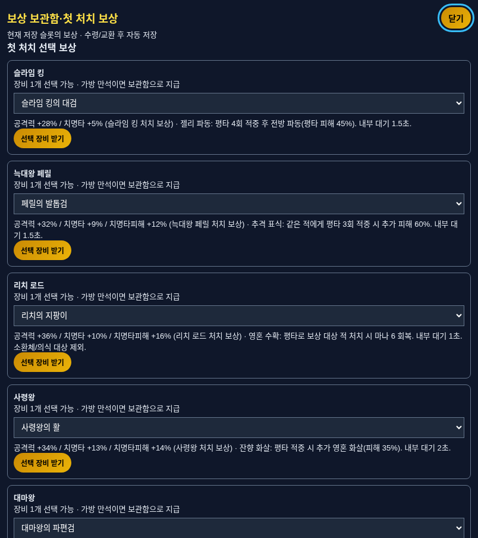

# v5.5.0 — 장비·보상 1차

보상 보관함, 다섯 보스의 첫 처치 선택 보상/장비 교환, 대표 무기 7종의 고유 특성을 구현했습니다. 기존 적 HP·피해·공격 시간·경험치 곡선·던전 목표·드롭 확률은 유지합니다. 특성/새 보상 정책의 체감 수치 조정은 이후 실제 플레이 밸런스 작업에서 수행합니다.

## 보상 보관함과 첫 보상

- 가방이 가득 찬 장비는 30~70골드로 바꾸지 않고 보관합니다. 같은 아이템·출처는 수량으로 묶습니다. 던전/탑 드롭, 첫 처치 선택 보상을 구분합니다.
- 일시정지 메뉴 또는 대장간의 **보상 보관함·첫 보상**에서 확인합니다. 장비별 또는 일괄 수령은 가방 빈칸만 사용하고 나머지 수량은 남깁니다.
- 다섯 던전 보스 각각의 첫 처치는 해당 보스 장비 중 원하는 1개를 선택할 권리를 줍니다. 기존 무작위 드롭(보스30%/일반 기본4%/정예15%)과 별도입니다. 선택 전 능력치·고유 특성을 볼 수 있습니다.
- 첫 보상은 던전의 실제 보스 처치에만 연결합니다. 탑·환영·소환체·의식 대상·관리자 테스트는 일반 첫 보상 권리를 만들지 않습니다.
- 기존 저장에서 이미 처치한 보스도 보관함에서 한 번 선택할 수 있습니다. 선택 상태는 잠금/수령 가능/수령 완료로 저장해 재클릭·재접속 시 중복 지급을 막습니다.

## 다섯 보스 장비 교환

대장간의 **보스 장비 교환**에서 같은 보스 장비3개를 같은 보스의 원하는 장비1개로 바꿉니다. 기존 대마왕 교환을 다섯 보스로 확장했습니다. 교환 미리보기에 소비할 장비 이름/가방 칸과 결과물을 표시하고, 확인 뒤 다시 재료를 검증합니다. 잠금·착용 장비·다른 보스 장비는 소비하지 않습니다. 재료가 비워진 칸에 결과물을 넣으므로 가방 만석에서도 교환할 수 있습니다.

## 고유 특성 초기 값

계수는 특성을 발동한 평타의 피해 굴림 기준입니다. 표적의 저항·취약 상태 등 공통 피해 처리는 각 타격에 적용됩니다. 60게임 틱=1초이며 화면 재그리기는 발동/피해/충전을 만들지 않습니다.

| 무기 | 특성 | 조건 / 효과 | 내부 대기 |
| --- | --- | --- | --- |
| 슬라임 킹의 대검 | 젤리 파동 | 평타4회 적중 → 전방 반경150·반각0.75rad 파동, 피해45% | 90틱(1.5초) |
| 페릴의 발톱검 | 추격 표식 | 같은 적에게 평타3회 적중 → 같은 적 추가 피해60% | 90틱(1.5초) |
| 리치의 지팡이 | 영혼 수확 | 평타로 던전/탑의 보상 대상 적 처치 → 마나6 회복, 최대MP 상한 적용 | 60틱(1초) |
| 사령왕의 활 | 잔향 화살 | 평타 적중 → 대상 방향 영혼 화살1발, 피해35% | 120틱(2초) |
| 대마왕의 파편검 | 파편 공명 | 평타5회 적중 → 전방 반경165·반각0.75rad 파편 베기, 피해50% | 150틱(2.5초) |
| 대마왕의 파편궁 | 파편 공명 | 평타5회 적중 → -0.25/0/+0.25rad 화살3발, 각 피해30% | 150틱(2.5초) |
| 대마왕의 파편지팡이 | 파편 공명 | 평타5회 적중 → 대상의 적중 위치 주변 반경90 폭발, 피해50% | 150틱(2.5초) |

- 스킬과 특성의 추가 타격은 충전/추가 특성을 발동하지 않습니다. 한 번의 평타는 여러 적을 베거나 관통/범위 피해를 주어도 충전1회로 계산합니다. 수확은 범위 피해의 처치도 확인하되 한 번의 공격/대기시간에 중복 회복하지 않습니다.
- 소환체·환영·작은 분열체·의식 대상은 충전/수확 대상으로 세지 않습니다. 공격형 특성은 스승 결투와 훈련장에서도 사용할 수 있으며, 스승/허수아비는 수확 마나를 주지 않습니다.
- 대기 중에는 충전하지 않습니다. 무기 교체 시 충전/표식/예약 타격/특성 탄을 정리하지만, 무기별 내부 대기시간은 해당 전투에서 유지해 교체로 대기를 건너뛰지 못하게 합니다.
- 기본 탄은 발사 당시 무기와 공격 ID를 유지합니다. 무기 교체 전 발사한 탄은 기본 피해를 주지만 교체 뒤 특성을 발동하지 않습니다. 새로 선택한 무기의 특성을 잘못 발동시키지 않습니다.
- 사망·재도전·맵/던전/탑 변경·불러오기·새 세션·스토리 전환 시 특성의 일시 상태를 정리합니다. 상태는 저장하지 않습니다.
- 예약 효과8개, 장식 효과24개, 특성 투사체12개와 수명 상한을 둡니다. 효과0에서도 특성 이름/충전/대기와 추격 대상 표식은 유지합니다. 음량/음소거 설정을 따릅니다.
- 장비 툴팁/비교와 상점·교환 카드에 조건·효과·대기를 표시합니다. 게임 화면 오른쪽 위에 현재 무기 특성의 충전/대기를 표시합니다. 기존 저장의 무기도 ID 기준으로 자동 적용됩니다.

## 저장과 일반/관리자 분리

저장 형식을 **6→7**로 올렸습니다. 버전1~6의 저장은 기존 진행과 장비를 유지하고, 처치한 보스의 첫 보상을 수령 가능 상태로 이전합니다. 현재 가방/착용 장비를 수집 발견 상태로 등록합니다. 1차 이후 획득/교환/구매한 장비의 발견 이력은 판매나 교환 뒤에도 남아 3차 도감으로 이어집니다. 과거에 이미 판매한 장비는 추정 등록하지 않습니다.

수령·교환은 전체 변경을 검증한 뒤 확정합니다. 자동 저장 사용 중에는 성공한 변경을 저장하고, 저장 실패 시 이번 수령/교환의 가방·보관함·첫 보상·잠금 변경을 모두 복구합니다. 기존 저장 원본을 유지하며 다시 시도할 수 있습니다. 자동 저장을 끈 경우 화면에 수동 저장 필요 안내를 표시하고 설정을 존중합니다. 전투 드롭은 메모리에 보존한 뒤 기존 주기/수동 저장에 포함합니다.

관리자 코드6974의 **장비 특성·보상 테스트**에서 일곱 무기와 보관함/첫 보상 샘플을 확인할 수 있습니다. 무기 테스트는 AI 정지 상태에서 실제 평타로 진행하며 수확 테스트는 HP1 표적과 부족한 마나를 준비합니다. 관리자 전용 저장/진입 전 복귀 지점에 분리되어 일반 슬롯의 보상·수집 상태를 덮지 않습니다.

## 검증

- `npm run test:rewards`: 보관/출처별 집계·저장 왕복, 버전1/5/6 이전, 잘못된 저장 거부, 첫 보상 조건·중복 방지, 가방 공간별 수령, 저장 실패 시 수령/교환 복구, 다섯 보스 교환·잠금·재료 변경 보호, 수집 이력/슬롯 분리, 관리자 복귀, 키보드·포커스·작은 화면·버튼 가림 방지·선택 장비 미리보기.
- `npm run test:traits`: 7무기의 실제 평타 발동, 범위/관통 중복 충전 방지, 시뮬레이션과 렌더 분리, 추격 표적 변경/사망, 무기 교체·대기 보존·미착탄 무기 ID, 비활성 무기/스킬/추가 타격 제외, 소환체 제외, 수확 상한/범위 처치, 이탈/불러오기 정리, 효과0·툴팁·관리자, 결투/훈련, 30·60·144Hz 피해/충전/대기 일치.
- 전체 기존 회귀를 함께 실행해 저장·입력·장비·다섯 던전·탑·스승·각성·엔딩·관리자 보호를 확인합니다. 수치의 재미/체감 난이도 검증과 기능·판정 검증을 구분합니다.
- Chromium에서 보관함/첫 선택/교환 미리보기/320×360 화면과 일곱 특성의 실제 발동 화면을 캡처해 페이지 오류를 확인합니다.

다음은 계획의 **2차 v5.6.0 전투 화면·연출**입니다.

로컬 검사 결과: 전체 회귀354개 통과. 이후 추가한 주사율/작은 화면 보완을 포함한 보상·특성44개 및 선택 장비 미리보기 보상21개 통과. 최종 GitHub 자동 검사에서는 주사율 검사까지 합쳐355개를 실행합니다.
