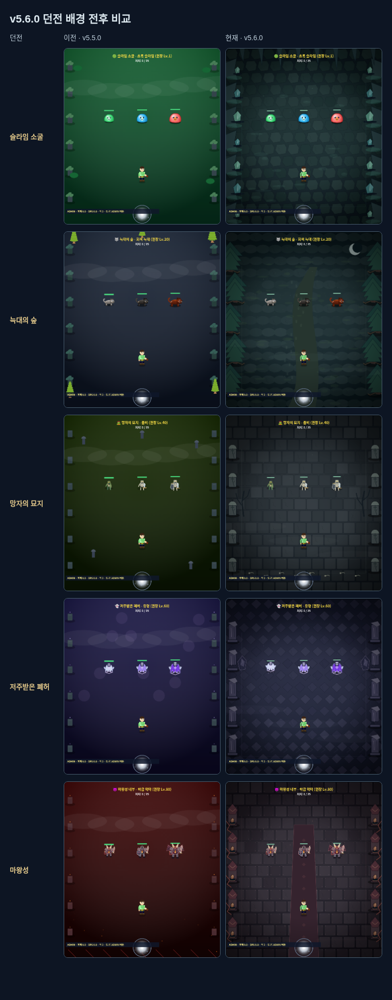
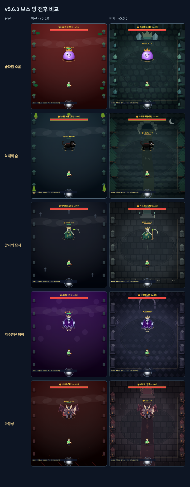

# v5.6.0 — 전투 화면·연출 2차

다섯 던전의 배경과 보스방을 개편하고, 캐릭터 재질·명중 반응·특성 연출·전리품 알림을 정리했습니다. 몬스터 능력치, 공격 범위/준비/활성/후딜 시간, 무기 특성의 조건/계수/대기시간, 성장·보상·드롭 확률은 v5.5.0과 같습니다. 실제 플레이 밸런스 조정은 이후에 진행합니다.

## 던전 배경과 보스방

일반·정예·생존·보스의 네 구역을 다섯 던전에서 구분해 총20개 배경을 사용합니다. 바닥 장식과 가장자리 소품은 배경이며 충돌 지형을 추가하지 않습니다.

| 던전 | 바닥과 주변 | 보스방 |
| --- | --- | --- |
| 슬라임 소굴 | 불규칙한 암반·젖은 반사·젤 자국·광물 | 왕관 형태의 젤 왕좌·결정 |
| 늑대의 숲 | 흙과 이끼·풀·뿌리·소나무·발자국·월광 | 송곳니 입구의 페릴 둥지 |
| 망자의 묘지 | 금 간 석재·묘비·십자가·앙상한 가지 | 뼈 제단·촛불·의식 문양 |
| 저주받은 폐허 | 마름모 석재·부서진 기둥·거울 파편·안개 | 갈라진 영혼 문·중앙 문양 |
| 마왕성 | 이음쇠가 있는 흑철·붉은 카펫·균열·화로 | 뿔 왕좌·흑요석 기둥 |

정예/생존은 색조·테두리·문양을 달리합니다. 전투 중앙은 바닥 재질 위주로 유지하고 큰 소품은 가장자리에 배치합니다.

## 캐릭터와 필수 공격 정보

- 주인공과 공통 NPC 렌더러에 어두운 윤곽, 머리/옷의 명암, 바느질과 장비 가장자리 빛을 더했습니다. NPC 역할·위치·대사와 기존 장비 외형 ID를 유지합니다.
- 몬스터의 접지 그림자와 명중 가장자리 빛을 추가했습니다. 보스·정예·일반·파괴 대상의 체력바 크기를 구분하고, 소환체/정예/파괴 대상의 이름과 표식을 함께 표시합니다.
- 적의 필수 예고는 본체·스킬·특성·피해 숫자·목표 표시 뒤에 한 번 그립니다. 산성 장판 경계도 마지막에 남깁니다. 판정에 사용하는 고정 좌표·방향·범위는 바꾸지 않습니다.
- 작은 화면에서는 위험이 진행되는 동안 중앙 전투 요약을 잠시 감추고 위험이 끝나면 돌려놓습니다. 전리품 알림도 위험 예고/투사체/장판 중에 숨기며 표시 대기시간을 보존합니다.

## 전투·특성·획득 연출

검은 베기, 활은 화살 명중선, 지팡이는 방사형 마법 불꽃으로 명중 반응을 구분합니다. 치명타는 밝은 불꽃을 더하고, 피격은 발밑 테두리로 표시합니다. 보스의 실제 단계 값이 변할 때 전환 표시를 만들고, 처치 때 종족 색의 파편이 사라집니다. 새 연출은 추가 피해·경직·히트스톱을 만들지 않습니다.

일곱 무기의 다섯 특성 계열은 다음 모양과 전용 합성음으로 구분합니다. 세 파편 무기의 공격 방식과 계수는 1차 구현을 그대로 사용합니다.

| 특성 | 표현 |
| --- | --- |
| 젤리 파동 | 젤 방울·전방 부채꼴 파동·낮은 물방울 음 |
| 추격 표식 | 표적 괄호·발톱선·짧은 이중 타격음 |
| 영혼 수확 | 위로 올라오는 영혼·마나 빛·상승음 |
| 잔향 화살 | 방향을 가진 화살선·뒤따르는 잔상·높은 잔향음 |
| 파편 공명 | 회전하는 마름모 파편·낮은 공명음 |

피해 숫자는 가까운 같은 유형/색상의 연속 피해를 짧은 구간에서 합산해 총량과 `×횟수`를 표시합니다. 적에게 준 피해와 플레이어가 받은 HP 피해는 따로 유지합니다. 윤곽선과 위치 분산을 적용하고 화면 경계 안으로 제한합니다.

전리품 알림에는 장비명·등급·가방 지급/보관함 보관을 표시합니다. 같은 장비·출처·수령 위치는 수량으로 합치며 최대4건, 작은 화면에서는 최신1건을 보여줍니다. 첫 처치 선택과 교환 완료도 구분합니다. 성공한 지급/교환 뒤에만 알림을 만들며 보상 원장과 아이템 수량은 바꾸지 않습니다.

## 설정·성능·관리자 확인

- 효과 강도를 배경 입자/안개·명중 불꽃·무기 궤적과 기존 장식 효과에 적용했습니다. 효과0에서는 장식을 생략하며 필수 공격 예고·실제 투사체·안전 통로·특성 발동의 작은 표시는 유지합니다. 기존 효과 내부의 전투 갱신은 계속 실행합니다.
- 전용 소리는 기존 음소거·음량을 따릅니다. 흔들림과 히트스톱은 기존 설정을 유지합니다.
- 배경은 게임 난수와 별도의 고정 시드로 만들고 캐시를 최대8장으로 제한합니다. 800×900 RGBA 기준 원시 픽셀은 약23MB이며 실제 브라우저 메모리는 구현에 따라 달라집니다. 반복 프레임은 캐시 이미지 한 번과 제한된 주변 입자만 그립니다.
- 배경 입자는 최대12개와 안개3줄, 새 명중/전환/사망 효과는72개, 피해 숫자는96개로 제한합니다. 수명은 게임 틱으로 진행하고 메뉴 정지와 30/60/144Hz를 따릅니다.
- 설정 → 관리자 코드 `6974` → 관리자 도구의 **던전 배경·등급 미리보기**에서 20개 구역을 확인합니다. 미리보기는 일반 진행·보상·복구 지점·게임 난수를 변경하지 않습니다. 실제 전투와 무기 특성은 기존 던전/패턴/특성 테스트 도구를 사용합니다.
- 저장 형식은7이며 신규 영구 필드는 없습니다. 새 게임/불러오기/관리자 복귀 때 표시 상태를 정리하고 다른 슬롯의 획득 알림을 가져오지 않습니다.

## 검증과 범위

최종 전체 검사 구성은 `npm test`의386개입니다. 로컬에서 회귀385개와 마지막 보완을 포함한 연출 전용30개가 통과했습니다. 전용 명령은 `npm run test:presentation`이며 GitHub Actions에서도 전체 검사를 실행합니다.

v5.5.0 기준 커밋 `11a7320b54ce859115b92ab0a889114818004bba`에서 얻은 고정 결과를 새 구현과 비교합니다. 다섯 보스×세 난이도에서 각각1,200틱, 총18,000틱을 실행해 HP/MP·위치·공격 단계와 타이머·투사체·피격 기록·특성 발동·게임 난수 호출/시드와 처치 후 골드/경험치/아이템/진행/보상 원장이 일치함을 확인했습니다.

이 비교는 레벨100·대표 무기·보스25% 체력, 높은 체력 상한으로 전투를 유지하고 60틱마다 실제 평타 입력을 전달하는 재현 시나리오입니다. 새 전환/명중 효과의 그리기는 피해를 만들지 않는지도 따로 검사합니다. 모든 플레이 조합의 동일성을 증명하거나 실제 난이도를 평가하는 검사는 아닙니다.

20개 구역, 일곱 특성 무기의 실제 발동 화면, 주인공/NPC 재질, 데스크톱과320×360 화면의 사령왕 안전 회랑·대마왕 심판을 효과0/1과 겹친 명중/특성/피해 숫자로 확인했습니다. 확인 스크립트에서 처리되지 않은 페이지 오류는 없었습니다. 자동 검사는 배경 재현성/캐시/그리기 상태 보존, 예고 레이어, 효과 상한/수명, 알림 집계와 위험 중 대기, 관리자 미리보기, 작은 화면·키보드·30/60/144Hz를 포함합니다. 실기기 GPU 성능과 스피커 출력을 측정한 결과는 아닙니다.

다음은 **3차 v5.7.0 도감·전투 기록**입니다. 몬스터/장비 수집과 보스 공략 정보, 개인 전투 기록·재도전 목표를 연결하며 실제 플레이 밸런스 점검은 그 뒤에 진행합니다.
